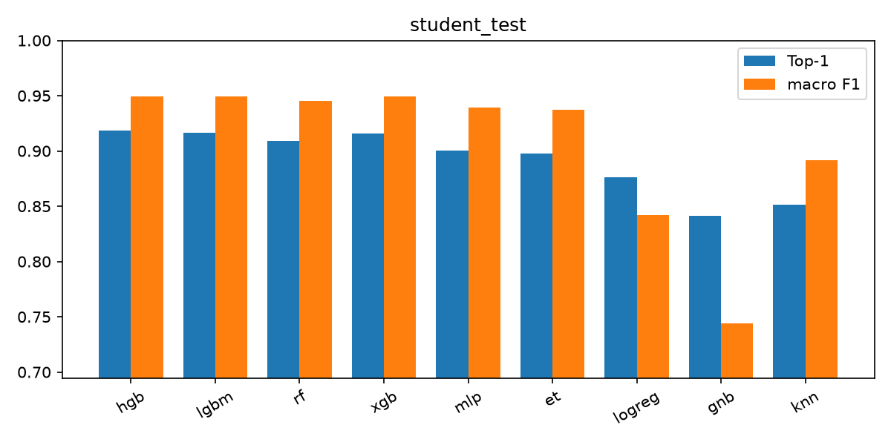
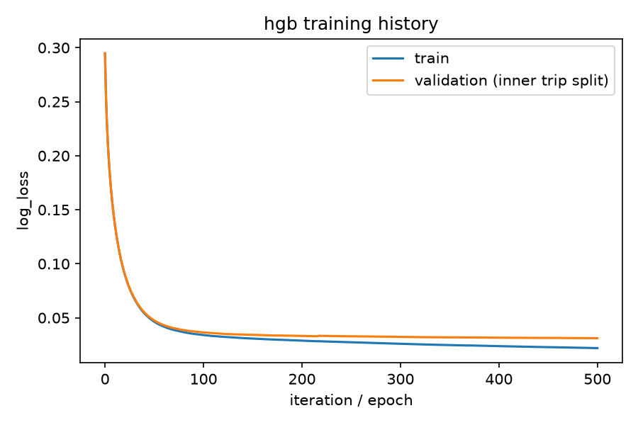
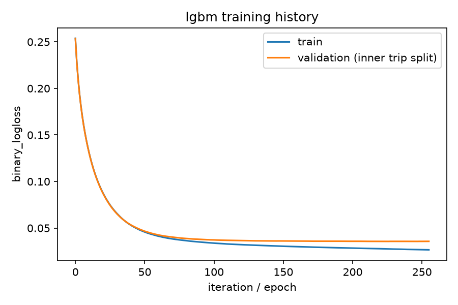
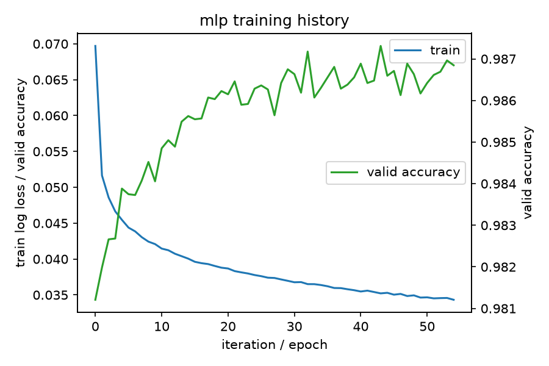
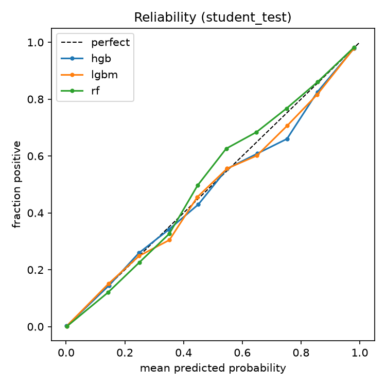
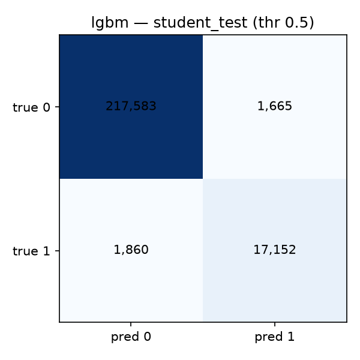

# 3. Model Experimentation and Comparison

## 3.1 Set-up

- **Task framing:** every GPS observation has a set of candidate road arcs (M1). Each *(observation, candidate)* row is a binary example (1 = ground-truth arc). The classifier's probability ranks the candidates of an observation and is passed to the HMM (§5) as the emission score.
- **Labels:** M3's order-preserving alignment of the reference route to the GPS track; observations whose alignment is unreliable (`label_valid = False`) are excluded from training and scoring.
- **Features:** the 23 features listed in `artifacts/feature_list.json` (M1).
- **Training rows:** every 4th GPS point of each train trip with all its candidates (516,188 valid rows; Random Forest / Extra Trees capped at 500,000 rows, KNN at 100,000).
- **Validation:** 5-fold `GroupKFold` by `trip_id` — a trip is never split between training and validation.
- **Development test:** the 10 `student_test` trips (all points). Evaluator trips were never used.
- **Primary metric:** observation Top-1 accuracy — share of valid GPS points whose highest-probability candidate is the ground-truth arc (pooled over points). Also reported: pair-level accuracy, precision, recall, F1, macro-F1 and log loss at threshold 0.5, undirected Top-1, route continuity, training and inference time.
- **Selection rule (fixed before the runs):** highest CV Top-1, ties broken by CV log loss, then inference speed.
- Seed 42 everywhere. Source files: `results/m2/model_comparison_v1.csv`, `metrics_summary_v1.csv`, `cv_folds_v1.csv`; notebook `notebooks/02_models.ipynb`.

> ✍️ **WRITE (own words):** 1–2 sentences on why Top-1 (not pair accuracy) is the primary metric. Evidence: on student_test, always predicting "not the true arc" already gives pair accuracy 0.9202.

## 3.2 Overall model comparison

| Model | Family | CV Top-1 | CV macro-F1 | CV log loss | ST Top-1 | ST macro-F1 | ST precision | ST recall | ST log loss | Train time (s) | Inference (ms / 1k rows) |
|---|---|---|---|---|---|---|---|---|---|---|---|
| HistGradientBoosting | boosting (sklearn hist) | 0.9138 ± 0.0180 | 0.9483 ± 0.0101 | 0.0410 | 0.9185 | 0.9494 | 0.9104 | 0.9033 | 0.0374 | 15.3 | 4.34 |
| LightGBM | boosting (LightGBM) | 0.9137 ± 0.0194 | 0.9485 ± 0.0110 | 0.0407 | 0.9162 | 0.9494 | 0.9115 | 0.9022 | 0.0373 | 5.0 | 1.73 |
| Random Forest | ensemble (bagging) | 0.9136 ± 0.0201 | 0.9472 ± 0.0113 | 0.0419 | 0.9089 | 0.9452 | 0.9248 | 0.8745 | 0.0399 | 70.9 | 1.88 |
| XGBoost | boosting (XGBoost) | 0.9130 ± 0.0197 | 0.9474 ± 0.0102 | 0.0412 | 0.9158 | 0.9496 | 0.9126 | 0.9020 | 0.0375 | 6.0 | 0.83 |
| Multi-layer Perceptron (MLP) | neural network | 0.9095 ± 0.0185 | 0.9428 ± 0.0098 | 0.0511 | 0.9005 | 0.9393 | 0.8946 | 0.8819 | 0.0458 | 255.4 | 1.51 |
| Extra Trees | ensemble (randomised trees) | 0.9058 ± 0.0209 | 0.9433 ± 0.0118 | 0.0468 | 0.8980 | 0.9373 | 0.9279 | 0.8444 | 0.0451 | 28.7 | 5.63 |
| Logistic Regression | linear / probabilistic | 0.8984 ± 0.0216 | 0.8599 ± 0.0164 | 0.1316 | 0.8759 | 0.8421 | 0.5698 | 0.9712 | 0.1405 | 3.0 | 0.09 |
| Gaussian Naive Bayes | probabilistic (naive Bayes) | 0.8647 ± 0.0199 | 0.7556 ± 0.0222 | 0.9920 | 0.8412 | 0.7444 | 0.3926 | 0.9756 | 1.0526 | 0.2 | 0.31 |
| k-Nearest Neighbours | instance-based | 0.8545 ± 0.0207 | 0.8993 ± 0.0101 | 0.1011 | 0.8511 | 0.8918 | 0.8667 | 0.7423 | 0.0999 | 0.0 | 45.45 |

CV = mean ± std over the 5 trip-grouped folds; ST = student_test. Train time = final fit on all training rows.

**Additional student_test metrics**

| Model | Accuracy | F1 | ROC-AUC | PR-AUC | Undirected Top-1 | Route continuity | Breaks |
|---|---|---|---|---|---|---|---|
| HistGradientBoosting | 0.9852 | 0.9069 | 0.9967 | 0.9691 | 0.9518 | 0.793 | 797 |
| LightGBM | 0.9852 | 0.9068 | 0.9967 | 0.9701 | 0.9515 | 0.793 | 793 |
| Random Forest | 0.9843 | 0.8990 | 0.9963 | 0.9670 | 0.9487 | 0.788 | 862 |
| XGBoost | 0.9853 | 0.9073 | 0.9967 | 0.9696 | 0.9509 | 0.795 | 783 |
| Multi-layer Perceptron (MLP) | 0.9823 | 0.8882 | 0.9953 | 0.9574 | 0.9459 | 0.767 | 928 |
| Extra Trees | 0.9823 | 0.8842 | 0.9958 | 0.9625 | 0.9395 | 0.735 | 1185 |
| Logistic Regression | 0.9392 | 0.7182 | 0.9909 | 0.9179 | 0.9253 | 0.715 | 1178 |
| Gaussian Naive Bayes | 0.8776 | 0.5599 | 0.9715 | 0.6382 | 0.9206 | 0.692 | 1553 |
| k-Nearest Neighbours | 0.9703 | 0.7997 | 0.9801 | 0.8790 | 0.8919 | 0.642 | 1807 |

> ✍️ **WRITE (own words):** 3–4 sentences comparing the families: which group leads, how large the gaps are, and what the precision/recall pattern of Logistic Regression and Gaussian NB says (use the table).

## 3.3 Individual models

### 3.3.1 HistGradientBoosting (boosting (sklearn hist))

- **Hyperparameters (initial values):** `learning_rate=0.05`; `max_leaf_nodes=31`; `max_iter=500`; `early_stopping=True`; `validation_fraction=0.1`; `n_iter_no_change=30`; `random_state=42`. Early stopping on a random 10 % of training rows, 30 iterations without improvement.
- **Loss / objective:** Binary log loss (`log_loss`); early stopping on validation loss.
- **student_test:** Top-1 0.9185, macro-F1 0.9494, log loss 0.0374, precision 0.9104, recall 0.9033.
- **Cross-validation:** Top-1 0.9138 ± 0.0180 (folds: 0.8826, 0.9308, 0.9303, 0.9066, 0.9186), log loss 0.0410.
- **Over/under-fitting evidence:** mean training-fold Top-1 0.9583 vs CV Top-1 0.9138 (gap +0.0445); fold std 0.0180.

> ✍️ **WRITE (own words):** **Why suitable** — why scikit-learn's histogram boosting is a reasonable boosting baseline (binned features, built-in early stopping).

> ✍️ **WRITE (own words):** **Strengths / limitations** — relate to the numbers above (accuracy, calibration/log loss, speed).

> ✍️ **WRITE (own words):** **Over/under-fitting** — interpret the gap and fold std above (and the training curve).

### 3.3.2 LightGBM (boosting (LightGBM))

- **Hyperparameters (initial values):** `n_estimators=500`; `learning_rate=0.05`; `num_leaves=31`; `random_state=42`. Early stopping (30 rounds) on an inner split of the training trips (15 % of trips).
- **Loss / objective:** Binary log loss (cross-entropy), minimised by gradient boosting; early stopping on log loss.
- **student_test:** Top-1 0.9162, macro-F1 0.9494, log loss 0.0373, precision 0.9115, recall 0.9022.
- **Cross-validation:** Top-1 0.9137 ± 0.0194 (folds: 0.8795, 0.9332, 0.9296, 0.9065, 0.9195), log loss 0.0407.
- **Over/under-fitting evidence:** mean training-fold Top-1 0.9431 vs CV Top-1 0.9137 (gap +0.0294); fold std 0.0194.

> ✍️ **WRITE (own words):** **Why suitable** — why gradient-boosted trees fit a tabular, imbalanced (observation, candidate) problem with interacting features (e.g. distance × heading).

> ✍️ **WRITE (own words):** **Strengths / limitations** — relate to the numbers above (accuracy, calibration/log loss, speed).

> ✍️ **WRITE (own words):** **Over/under-fitting** — interpret the gap and fold std above (and the training curve).

### 3.3.3 Random Forest (ensemble (bagging))

- **Hyperparameters (initial values):** `n_estimators=300`; `max_depth=None`; `min_samples_leaf=5`; `random_state=42`. Trained on at most 500,000 rows (whole GPS points sampled) for time.
- **Loss / objective:** No global loss; each split minimises Gini impurity. Probabilities = mean of leaf class frequencies over trees.
- **student_test:** Top-1 0.9089, macro-F1 0.9452, log loss 0.0399, precision 0.9248, recall 0.8745.
- **Cross-validation:** Top-1 0.9136 ± 0.0201 (folds: 0.8808, 0.9343, 0.9320, 0.9019, 0.9193), log loss 0.0419.
- **Over/under-fitting evidence:** mean training-fold Top-1 0.9705 vs CV Top-1 0.9136 (gap +0.0568); fold std 0.0201.

> ✍️ **WRITE (own words):** **Why suitable** — why a bagged tree ensemble suits these features (non-linear, robust, little tuning).

> ✍️ **WRITE (own words):** **Strengths / limitations** — relate to the numbers above (accuracy, calibration/log loss, speed).

> ✍️ **WRITE (own words):** **Over/under-fitting** — interpret the gap and fold std above.

### 3.3.4 XGBoost (boosting (XGBoost))

- **Hyperparameters (initial values):** `n_estimators=500`; `learning_rate=0.05`; `max_depth=6`; `random_state=42`. `tree_method=hist`; early stopping (30 rounds) on an inner split of the training trips (15 % of trips).
- **Loss / objective:** Binary log loss (`binary:logistic`, eval metric `logloss`), with L2 leaf regularisation; early stopping on log loss.
- **student_test:** Top-1 0.9158, macro-F1 0.9496, log loss 0.0375, precision 0.9126, recall 0.9020.
- **Cross-validation:** Top-1 0.9130 ± 0.0197 (folds: 0.8788, 0.9335, 0.9305, 0.9064, 0.9156), log loss 0.0412.
- **Over/under-fitting evidence:** mean training-fold Top-1 0.9419 vs CV Top-1 0.9130 (gap +0.0289); fold std 0.0197.

> ✍️ **WRITE (own words):** **Why suitable** — why a second boosting library (level-wise trees, different regularisation) is a useful comparison to LightGBM.

> ✍️ **WRITE (own words):** **Strengths / limitations** — relate to the numbers above (accuracy, calibration/log loss, speed).

> ✍️ **WRITE (own words):** **Over/under-fitting** — interpret the gap and fold std above (and the training curve).

### 3.3.5 Multi-layer Perceptron (MLP) (neural network)

- **Hyperparameters (initial values):** `hidden_layer_sizes=[64, 32]`; `activation=relu`; `solver=adam`; `early_stopping=True`; `max_iter=200`; `random_state=42`. Inputs standardised (`StandardScaler` inside the pipeline).
- **Loss / objective:** Log loss (cross-entropy) plus L2 penalty (`alpha`), optimised with Adam; early stopping on a 10 % validation split.
- **student_test:** Top-1 0.9005, macro-F1 0.9393, log loss 0.0458, precision 0.8946, recall 0.8819.
- **Cross-validation:** Top-1 0.9095 ± 0.0185 (folds: 0.8802, 0.9299, 0.9242, 0.8964, 0.9167), log loss 0.0511.
- **Over/under-fitting evidence:** mean training-fold Top-1 0.9353 vs CV Top-1 0.9095 (gap +0.0258); fold std 0.0185.

> ✍️ **WRITE (own words):** **Why suitable** — why a neural network was included for comparison on tabular features.

> ✍️ **WRITE (own words):** **Strengths / limitations** — relate to the numbers above (accuracy, calibration/log loss, speed).

> ✍️ **WRITE (own words):** **Over/under-fitting** — interpret the gap and fold std above (and the training curve).

### 3.3.6 Extra Trees (ensemble (randomised trees))

- **Hyperparameters (initial values):** `n_estimators=300`; `max_depth=None`; `min_samples_leaf=5`; `random_state=42`. Trained on at most 500,000 rows (whole GPS points sampled) for time.
- **Loss / objective:** No global loss; Gini impurity with randomly drawn split thresholds. Probabilities = mean of leaf frequencies.
- **student_test:** Top-1 0.8980, macro-F1 0.9373, log loss 0.0451, precision 0.9279, recall 0.8444.
- **Cross-validation:** Top-1 0.9058 ± 0.0209 (folds: 0.8738, 0.9292, 0.9240, 0.8903, 0.9118), log loss 0.0468.
- **Over/under-fitting evidence:** mean training-fold Top-1 0.9491 vs CV Top-1 0.9058 (gap +0.0432); fold std 0.0209.

> ✍️ **WRITE (own words):** **Why suitable** — how randomised split thresholds differ from Random Forest and what that should change.

> ✍️ **WRITE (own words):** **Strengths / limitations** — relate to the numbers above (accuracy, calibration/log loss, speed).

> ✍️ **WRITE (own words):** **Over/under-fitting** — interpret the gap and fold std above.

### 3.3.7 Logistic Regression (linear / probabilistic)

- **Hyperparameters (initial values):** `C=1.0`; `class_weight=balanced`; `max_iter=1000`; `random_state=42`. Inputs standardised (`StandardScaler` inside the pipeline).
- **Loss / objective:** Log loss (cross-entropy) plus L2 penalty (strength 1/C), with class weights `balanced`.
- **student_test:** Top-1 0.8759, macro-F1 0.8421, log loss 0.1405, precision 0.5698, recall 0.9712.
- **Cross-validation:** Top-1 0.8984 ± 0.0216 (folds: 0.8658, 0.9231, 0.9153, 0.8808, 0.9068), log loss 0.1316.
- **Over/under-fitting evidence:** mean training-fold Top-1 0.8989 vs CV Top-1 0.8984 (gap +0.0006); fold std 0.0216.

> ✍️ **WRITE (own words):** **Why suitable** — why a linear probabilistic baseline is useful here.

> ✍️ **WRITE (own words):** **Strengths / limitations** — relate to the numbers above (accuracy, calibration/log loss, speed).

> ✍️ **WRITE (own words):** **Over/under-fitting** — interpret the gap and fold std above.

### 3.3.8 Gaussian Naive Bayes (probabilistic (naive Bayes))

- **Hyperparameters (initial values):** `var_smoothing=1e-09`; `random_state=42`. 
- **Loss / objective:** No iterative loss; per-class Gaussian means/variances estimated by maximum likelihood, combined with Bayes' rule.
- **student_test:** Top-1 0.8412, macro-F1 0.7444, log loss 1.0526, precision 0.3926, recall 0.9756.
- **Cross-validation:** Top-1 0.8647 ± 0.0199 (folds: 0.8415, 0.8615, 0.8959, 0.8475, 0.8772), log loss 0.9920.
- **Over/under-fitting evidence:** mean training-fold Top-1 0.8653 vs CV Top-1 0.8647 (gap +0.0006); fold std 0.0199.

> ✍️ **WRITE (own words):** **Why suitable** — why it was included and which of its assumptions (feature independence) is violated by correlated distance features.

> ✍️ **WRITE (own words):** **Strengths / limitations** — relate to the numbers above (accuracy, calibration/log loss, speed).

> ✍️ **WRITE (own words):** **Over/under-fitting** — interpret the gap and fold std above.

### 3.3.9 k-Nearest Neighbours (instance-based)

- **Hyperparameters (initial values):** `n_neighbors=25`; `weights=distance`; `random_state=42`. Inputs standardised; trained on at most 100,000 rows because prediction cost grows with training size.
- **Loss / objective:** No loss (lazy learner); probability = distance-weighted vote of the 25 nearest training rows.
- **student_test:** Top-1 0.8511, macro-F1 0.8918, log loss 0.0999, precision 0.8667, recall 0.7423.
- **Cross-validation:** Top-1 0.8545 ± 0.0207 (folds: 0.8263, 0.8750, 0.8768, 0.8343, 0.8601), log loss 0.1011.
- **Over/under-fitting evidence:** mean training-fold Top-1 1.0000 vs CV Top-1 0.8545 (gap +0.1455); fold std 0.0207.

> ✍️ **WRITE (own words):** **Why suitable** — why an instance-based method was included and why scaling matters for it.

> ✍️ **WRITE (own words):** **Strengths / limitations** — relate to the numbers above (accuracy, calibration/log loss, speed).

> ✍️ **WRITE (own words):** **Over/under-fitting** — interpret the gap and fold std above.

## 3.4 Model selection

Per-fold CV Top-1 of LightGBM minus each other model (same folds):

| Compared with | Mean difference | Folds won by LightGBM (of 5) |
|---|---|---|
| HistGradientBoosting | -0.0001 | 2 |
| Random Forest | +0.0000 | 2 |
| XGBoost | +0.0007 | 3 |
| Multi-layer Perceptron (MLP) | +0.0042 | 4 |
| Extra Trees | +0.0078 | 5 |
| Logistic Regression | +0.0153 | 5 |
| Gaussian Naive Bayes | +0.0490 | 5 |
| k-Nearest Neighbours | +0.0592 | 5 |

**Selected model: LightGBM.**

> ✍️ **WRITE (own words):** the justification, using the selection rule: the top four CV Top-1 values (HistGB 0.9138, LightGBM 0.9137, Random Forest 0.9136, XGBoost 0.9130) and the per-fold table above; the log-loss tie-break (LightGBM 0.0407 vs 0.0410 / 0.0419 / 0.0412); over-fitting gaps; speed. Also say openly that HistGB has the higher student_test Top-1 (0.9185 vs 0.9162) and why student_test was not used for selection.

## 3.5 Effect of the labels

The same sweep was first run with provisional labels (nearest reference-route arc) before M3's alignment was available (`results/m2/model_comparison_v0.csv`). All results above use M3's labels.

| Model | CV Top-1 (provisional labels) | CV Top-1 (M3 labels) | Change |
|---|---|---|---|
| HistGradientBoosting | 0.8974 | 0.9138 | +0.0164 |
| LightGBM | 0.9000 | 0.9137 | +0.0137 |
| Random Forest | 0.8955 | 0.9136 | +0.0182 |
| XGBoost | 0.8978 | 0.9130 | +0.0152 |
| Multi-layer Perceptron (MLP) | 0.8958 | 0.9095 | +0.0137 |
| Extra Trees | 0.8927 | 0.9058 | +0.0131 |
| Logistic Regression | 0.8844 | 0.8984 | +0.0140 |
| Gaussian Naive Bayes | 0.8254 | 0.8647 | +0.0393 |
| k-Nearest Neighbours | 0.8447 | 0.8545 | +0.0098 |

> ✍️ **WRITE (own words):** 1–2 sentences on what this shows about label quality.

