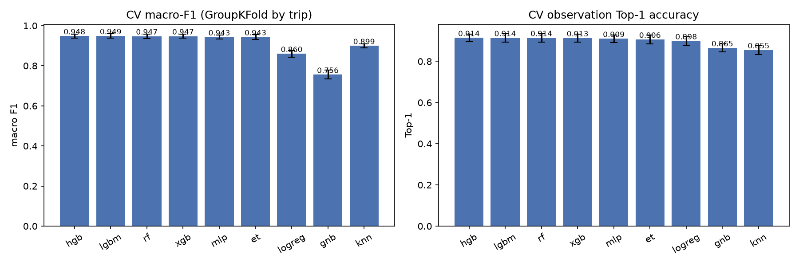
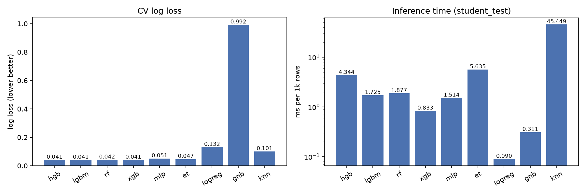

# 3. Model Experimentation and Comparison

## Experimental set-up

- **Task framing:** each GPS observation has a set of candidate road arcs from M1. Every *(observation, candidate)* row is a binary example, labelled 1 if it is the ground-truth arc. The classifier's probability is used to rank the candidates of an observation and is passed to the HMM (§5) as the emission score.
- **Labels:** taken from M3's order-preserving alignment of the reference route to the GPS track. Observations with an unreliable alignment (`label_valid = False`) are left out of training and scoring.
- **Features:** the 23 features in `artifacts/feature_list.json` (M1).
- **Training rows:** every 4th GPS point of each train trip, with all of its candidates (516,188 valid rows). Random Forest and Extra Trees were capped at 500,000 rows and KNN at 100,000.
- **Validation:** 5-fold `GroupKFold` on `trip_id`, so a trip is never split between training and validation.
- **Development test:** the 10 `student_test` trips (all points). The evaluator trips were not used at any stage.
- **Primary metric:** observation Top-1 accuracy, i.e. the share of valid GPS points whose highest-probability candidate is the ground-truth arc (pooled over points). We also report pair-level accuracy, precision, recall, F1, macro-F1 and log loss at a 0.5 threshold, plus undirected Top-1, route continuity, training time and inference time.
- **Selection rule (set before the runs):** highest CV Top-1, with ties broken by CV log loss and then by inference speed.
- Seed 42 throughout. Source files: `results/m2/model_comparison_v1.csv`, `metrics_summary_v1.csv`, `cv_folds_v1.csv`; notebook `notebooks/02_models.ipynb`.
Pair accuracy is not very useful for this problem. Only about one candidate in twelve is the true arc, so a model that always predicts "not the true arc" already gets 0.9202 pair accuracy on student_test. For map matching we need the correct arc for each GPS point, so models are ranked by observation Top-1. We also look at log loss, since the probabilities are used as the HMM's emission scores.

## 3.1 Overall Model Comparison

| Model | Algorithm family | Key configuration | CV macro-F1 | CV Top-1 | Student-test Top-1 | Route continuity (ST) | Student-test macro-F1 | Student-test log loss | Inference time (ms / 1k rows) |
|---|---|---|---|---|---|---|---|---|---|
| HistGradientBoosting | boosting (sklearn hist) | lr 0.05, 31 leaves, ≤500 iter, early stop | 0.9483 ± 0.0101 | 0.9138 ± 0.0180 | 0.9185 | 0.793 | 0.9494 | 0.0374 | 4.34 |
| LightGBM | boosting (LightGBM) | lr 0.05, 31 leaves, ≤500 trees, early stop | 0.9485 ± 0.0110 | 0.9137 ± 0.0194 | 0.9162 | 0.793 | 0.9494 | 0.0373 | 1.73 |
| Random Forest | ensemble (bagging) | 300 trees, min leaf 5 | 0.9472 ± 0.0113 | 0.9136 ± 0.0201 | 0.9089 | 0.788 | 0.9452 | 0.0399 | 1.88 |
| XGBoost | boosting (XGBoost) | lr 0.05, depth 6, ≤500 trees, early stop | 0.9474 ± 0.0102 | 0.9130 ± 0.0197 | 0.9158 | 0.795 | 0.9496 | 0.0375 | 0.83 |
| Multi-layer Perceptron (MLP) | neural network | (64, 32) ReLU, Adam, early stop | 0.9428 ± 0.0098 | 0.9095 ± 0.0185 | 0.9005 | 0.767 | 0.9393 | 0.0458 | 1.51 |
| Extra Trees | ensemble (randomised trees) | 300 trees, min leaf 5 | 0.9433 ± 0.0118 | 0.9058 ± 0.0209 | 0.8980 | 0.735 | 0.9373 | 0.0451 | 5.63 |
| Logistic Regression | linear / probabilistic | C=1, balanced class weights | 0.8599 ± 0.0164 | 0.8984 ± 0.0216 | 0.8759 | 0.715 | 0.8421 | 0.1405 | 0.09 |
| Gaussian Naive Bayes | probabilistic (naive Bayes) | var_smoothing 1e-9 | 0.7556 ± 0.0222 | 0.8647 ± 0.0199 | 0.8412 | 0.692 | 0.7444 | 1.0526 | 0.31 |
| k-Nearest Neighbours | instance-based | k=25, distance-weighted | 0.8993 ± 0.0101 | 0.8545 ± 0.0207 | 0.8511 | 0.642 | 0.8918 | 0.0999 | 45.45 |

CV = mean ± std over the 5 trip-grouped folds; ST = student_test (10 trips). Route continuity = share of consecutive predicted arcs (classifier argmax, before the HMM) that are connected in the road graph. All nine models output probabilities, so log loss applies to every model (no N/A entries). Full configurations are in §3.2 and `results/m2/configs/`; training times are in the additional table below.

**Additional student_test metrics**

| Model | Accuracy | F1 | ROC-AUC | PR-AUC | Undirected Top-1 | Route breaks | Train time (s) |
|---|---|---|---|---|---|---|---|
| HistGradientBoosting | 0.9852 | 0.9069 | 0.9967 | 0.9691 | 0.9518 | 797 | 15.3 |
| LightGBM | 0.9852 | 0.9068 | 0.9967 | 0.9701 | 0.9515 | 793 | 5.0 |
| Random Forest | 0.9843 | 0.8990 | 0.9963 | 0.9670 | 0.9487 | 862 | 70.9 |
| XGBoost | 0.9853 | 0.9073 | 0.9967 | 0.9696 | 0.9509 | 783 | 6.0 |
| Multi-layer Perceptron (MLP) | 0.9823 | 0.8882 | 0.9953 | 0.9574 | 0.9459 | 928 | 255.4 |
| Extra Trees | 0.9823 | 0.8842 | 0.9958 | 0.9625 | 0.9395 | 1185 | 28.7 |
| Logistic Regression | 0.9392 | 0.7182 | 0.9909 | 0.9179 | 0.9253 | 1178 | 3.0 |
| Gaussian Naive Bayes | 0.8776 | 0.5599 | 0.9715 | 0.6382 | 0.9206 | 1553 | 0.2 |
| k-Nearest Neighbours | 0.9703 | 0.7997 | 0.9801 | 0.8790 | 0.8919 | 1807 | 0.0 |

The four tree ensembles (HistGB, LightGBM, Random Forest and XGBoost) are ahead of the rest. Their CV Top-1 values are within 0.0008 of each other (0.9130 to 0.9138), which is much smaller than the fold standard deviation of about 0.02. MLP and Extra Trees are 0.004 to 0.008 behind, and the three simple models are 1.5 to 5.9 points behind. Logistic Regression and Gaussian NB have the opposite precision/recall pattern to the trees. On student_test their recall is above 0.97, but precision is only 0.57 and 0.39, so they mark many wrong candidates as positive. For Logistic Regression this comes from the class weighting, and for Gaussian NB from over-confident probabilities. Their Top-1 drops less than their F1, because Top-1 only needs the true arc to be ranked first and not to pass the 0.5 threshold.

## 3.2 Compulsory Questions for Every Model

Each subsection answers: why the algorithm suits PathSnap and its strengths/limitations (A), important hyperparameters with initial values and the loss/objective (B), and student-test performance (Top-1, macro-F1, log loss) with over/under-fitting evidence (C). Training/validation loss curves are shown only for the four models that produce real iteration histories (HistGB, LightGBM, XGBoost, MLP).

### 3.2.1 HistGradientBoosting (boosting (sklearn hist))

- **Hyperparameters (initial values):** `learning_rate=0.05`; `max_leaf_nodes=31`; `max_iter=500`; `early_stopping=True`; `validation_fraction=0.1`; `n_iter_no_change=30`; `random_state=42`. Early stopping uses a random 10 % of the training rows and stops after 30 iterations with no improvement.
- **Loss / objective:** binary log loss (`log_loss`), with early stopping on validation loss.
- **student_test:** Top-1 0.9185, macro-F1 0.9494, log loss 0.0374, precision 0.9104, recall 0.9033.
- **Cross-validation:** Top-1 0.9138 ± 0.0180 (folds: 0.8826, 0.9308, 0.9303, 0.9066, 0.9186), log loss 0.0410.
- **Over/under-fitting evidence:** mean training-fold Top-1 0.9583 vs CV Top-1 0.9138 (gap +0.0445); fold std 0.0180.

**Why suitable.** HistGradientBoosting bins each feature into a histogram and grows boosted trees on the bins. This keeps training fast on about half a million rows, and the trees can still combine features like distance, heading agreement and window consistency. It is part of scikit-learn and has early stopping built in, so we used it as our reference boosting model without adding another library.

**Strengths / limitations.** It had the best CV Top-1 (0.9138) and the best student_test Top-1 (0.9185) of the nine models, and its log loss (0.0410 CV, 0.0374 student_test) is very close to LightGBM's. It is slower than the other boosting models: 15.3 s to train and 4.34 ms per 1k rows, roughly 2.5 times LightGBM's inference time. Also, its early stopping uses a random 10 % of rows rather than whole trips, so the stopping signal may be a bit optimistic.

**Over/under-fitting.** Training-fold Top-1 is 0.0445 above CV. Among the tree models only Random Forest has a larger gap, so HistGB fits the training trips more closely than LightGBM or XGBoost do. In the loss curves, validation loss flattens after about 150 iterations while training loss keeps going down, and early stopping did not trigger within the 500-iteration limit. This explains the larger gap. (Here the validation curve comes from the random 10 % row split, not a trip split.) Its fold standard deviation (0.0180) is the lowest of the leading models, so results are stable across trip groups.

### 3.2.2 LightGBM (boosting (LightGBM))

- **Hyperparameters (initial values):** `n_estimators=500`; `learning_rate=0.05`; `num_leaves=31`; `random_state=42`. Early stopping (30 rounds) on an inner split of the training trips (15 % of trips).
- **Loss / objective:** binary log loss (cross-entropy), minimised by gradient boosting, with early stopping on log loss.
- **student_test:** Top-1 0.9162, macro-F1 0.9494, log loss 0.0373, precision 0.9115, recall 0.9022.
- **Cross-validation:** Top-1 0.9137 ± 0.0194 (folds: 0.8795, 0.9332, 0.9296, 0.9065, 0.9195), log loss 0.0407.
- **Over/under-fitting evidence:** mean training-fold Top-1 0.9431 vs CV Top-1 0.9137 (gap +0.0294); fold std 0.0194.

**Why suitable.** Whether a candidate is correct depends on combinations of features. For example, a nearby arc is only correct if its direction matches the vehicle's heading. Boosted trees can learn these interactions without us building feature crosses by hand. LightGBM grows trees leaf-wise on histogram bins, trains quickly on our training set, and its log-loss objective gives probabilities that can go straight into the HMM as emissions.

**Strengths / limitations.** Its CV Top-1 is statistically tied with the best (0.9137 vs 0.9138 for HistGB). It has the lowest CV log loss of the nine models (0.0407) and the best student_test PR-AUC (0.9701), and it is fast, at 5.0 s to train and 1.73 ms per 1k rows. The main drawback is the number of hyperparameters that interact with each other (leaves, learning rate, sampling, regularisation). We tuned these with Bayesian optimisation in §4.

**Over/under-fitting.** Training-fold Top-1 is 0.0294 above CV and the fold standard deviation is 0.0194, which points to mild over-fitting that stays under control. Only XGBoost has a slightly smaller gap (0.0289). The loss curves show the same thing: training and validation loss drop together for the first ~50 iterations, validation loss levels off at around 100 iterations, and early stopping ended training at about 255 iterations, before the two curves moved further apart.

### 3.2.3 Random Forest (ensemble (bagging))

- **Hyperparameters (initial values):** `n_estimators=300`; `max_depth=None`; `min_samples_leaf=5`; `random_state=42`. Trained on at most 500,000 rows (sampled as whole GPS points) to keep the run time down.
- **Loss / objective:** no global loss; each split minimises Gini impurity. Probabilities are the mean of the leaf class frequencies across trees.
- **student_test:** Top-1 0.9089, macro-F1 0.9452, log loss 0.0399, precision 0.9248, recall 0.8745.
- **Cross-validation:** Top-1 0.9136 ± 0.0201 (folds: 0.8808, 0.9343, 0.9320, 0.9019, 0.9193), log loss 0.0419.
- **Over/under-fitting evidence:** mean training-fold Top-1 0.9705 vs CV Top-1 0.9136 (gap +0.0568); fold std 0.0201.
**Why suitable.** Random Forest averages hundreds of deep trees, each grown on a bootstrap sample with a random subset of features. It picks up non-linear rules with little tuning and handles outliers such as GPS jumps well. We included it as the bagging alternative to the boosted models.

**Strengths / limitations.** Its CV Top-1 (0.9136) is on par with the boosting models, and its student_test precision (0.9248) is the highest in the leading group. Recall is lower, though (0.8745), student_test Top-1 falls to 0.9089, and log loss is a little worse (0.0419 CV). The reliability curve shows it is under-confident in the middle of the probability range. It is also the slowest tree model to train (70.9 s, even with the 500,000-row cap).

**Over/under-fitting.** Random Forest has the largest gap of the tree models, with training-fold Top-1 at 0.9705 against 0.9136 in CV (+0.0568). Fully grown trees (`max_depth=None`, leaf size 5) come close to memorising the training trips. Averaging keeps the CV score competitive, but given the gap and the weaker student_test result, we would need a larger leaf size or a depth limit if we chose this model.

### 3.2.4 XGBoost (boosting (XGBoost))

- **Hyperparameters (initial values):** `n_estimators=500`; `learning_rate=0.05`; `max_depth=6`; `random_state=42`. `tree_method=hist`; early stopping (30 rounds) on an inner split of the training trips (15 % of trips).
- **Loss / objective:** binary log loss (`binary:logistic`, eval metric `logloss`) with L2 regularisation on leaf weights, and early stopping on log loss.
- **student_test:** Top-1 0.9158, macro-F1 0.9496, log loss 0.0375, precision 0.9126, recall 0.9020.
- **Cross-validation:** Top-1 0.9130 ± 0.0197 (folds: 0.8788, 0.9335, 0.9305, 0.9064, 0.9156), log loss 0.0412.
- **Over/under-fitting evidence:** mean training-fold Top-1 0.9419 vs CV Top-1 0.9130 (gap +0.0289); fold std 0.0197.

**Why suitable.** XGBoost grows each tree level by level up to a fixed depth and adds an L2 penalty on the leaf weights. Since it is a different boosting implementation, it also lets us check that LightGBM's result is not specific to one library.

**Strengths / limitations.** It was 0.0007 below LightGBM in CV Top-1 (0.9130), with similar log loss (0.0412). On student_test it had the best macro-F1 (0.9496), the best route continuity (0.795) and the fastest inference of the tree models (0.83 ms per 1k rows). It is also the only model in our set that can train on a GPU. Even so, its CV Top-1 and log loss were slightly behind LightGBM and HistGB.

**Over/under-fitting.** Its training–CV gap (+0.0289) is the smallest of the leading models, and the fold standard deviation is 0.0197. In the loss curves, validation loss flattens after about 100 rounds and stays close to training loss until early stopping ends training at about 400 rounds. Of the top group, XGBoost over-fits the least.

### 3.2.5 Multi-layer Perceptron (MLP) (neural network)

- **Hyperparameters (initial values):** `hidden_layer_sizes=[64, 32]`; `activation=relu`; `solver=adam`; `early_stopping=True`; `max_iter=200`; `random_state=42`. Inputs standardised (`StandardScaler` in the pipeline).
- **Loss / objective:** log loss (cross-entropy) plus an L2 penalty (`alpha`), optimised with Adam, with early stopping on a 10 % validation split.
- **student_test:** Top-1 0.9005, macro-F1 0.9393, log loss 0.0458, precision 0.8946, recall 0.8819.
- **Cross-validation:** Top-1 0.9095 ± 0.0185 (folds: 0.8802, 0.9299, 0.9242, 0.8964, 0.9167), log loss 0.0511.
- **Over/under-fitting evidence:** mean training-fold Top-1 0.9353 vs CV Top-1 0.9095 (gap +0.0258); fold std 0.0185.

**Why suitable.** A small fully connected network (64 and 32 ReLU units on standardised inputs) tests whether a smooth non-linear function of the features can do as well as the tree models. It also adds a neural network to the comparison.

**Strengths / limitations.** It was fifth in CV Top-1 (0.9095), about 0.004 behind the leaders. Its calibration is noticeably worse (CV log loss 0.0511 vs 0.0407 for LightGBM), and it took the longest to train of all the models (255.4 s). Inference is cheap (1.51 ms per 1k rows). Neural networks are sensitive to scaling and hyperparameters and usually need more tuning than trees on tabular data.

**Over/under-fitting.** The training–CV gap is small (+0.0258, fold standard deviation 0.0185), so there is little over-fitting. Training loss falls steadily, validation accuracy rises and levels off at around 0.987 after about 40 epochs, and early stopping ended training after roughly 55 epochs. The remaining gap to the trees is more likely due to limited capacity or tuning (mild under-fitting) than to over-fitting.

### 3.2.6 Extra Trees (ensemble (randomised trees))

- **Hyperparameters (initial values):** `n_estimators=300`; `max_depth=None`; `min_samples_leaf=5`; `random_state=42`. Trained on at most 500,000 rows (sampled as whole GPS points) to keep the run time down.
- **Loss / objective:** no global loss; Gini impurity with randomly drawn split thresholds. Probabilities are the mean of the leaf frequencies.
- **student_test:** Top-1 0.8980, macro-F1 0.9373, log loss 0.0451, precision 0.9279, recall 0.8444.
- **Cross-validation:** Top-1 0.9058 ± 0.0209 (folds: 0.8738, 0.9292, 0.9240, 0.8903, 0.9118), log loss 0.0468.
- **Over/under-fitting evidence:** mean training-fold Top-1 0.9491 vs CV Top-1 0.9058 (gap +0.0432); fold std 0.0209.
**Why suitable.** Extra Trees is similar to Random Forest, but it picks split thresholds at random instead of searching for the best one. This reduces variance and training time. We included it to see whether the extra randomness helps with noisy features derived from GPS.

**Strengths / limitations.** It trained about 2.5 times faster than Random Forest (28.7 s vs 70.9 s) and had the highest precision of all nine models (0.9279 on student_test). However, recall is low (0.8444), CV Top-1 is 0.0078 below LightGBM, and inference is the slowest of the tree models (5.63 ms per 1k rows). Because the thresholds are random, individual splits are less precise, which seems to hurt accuracy when distance and heading differences are small.

**Over/under-fitting.** Training-fold Top-1 is 0.0432 above CV. This is smaller than Random Forest's gap, which is what we would expect from randomised splits. Its fold standard deviation (0.0209) is the highest of the tree models. It over-fits less than Random Forest but also generalises slightly worse, so the extra randomness reduced variance at the cost of more bias.

### 3.2.7 Logistic Regression (linear / probabilistic)

- **Hyperparameters (initial values):** `C=1.0`; `class_weight=balanced`; `max_iter=1000`; `random_state=42`. Inputs standardised (`StandardScaler` in the pipeline).
- **Loss / objective:** log loss (cross-entropy) plus an L2 penalty (strength 1/C), with `balanced` class weights.
- **student_test:** Top-1 0.8759, macro-F1 0.8421, log loss 0.1405, precision 0.5698, recall 0.9712.
- **Cross-validation:** Top-1 0.8984 ± 0.0216 (folds: 0.8658, 0.9231, 0.9153, 0.8808, 0.9068), log loss 0.1316.
- **Over/under-fitting evidence:** mean training-fold Top-1 0.8989 vs CV Top-1 0.8984 (gap +0.0006); fold std 0.0216.
**Why suitable.** Logistic Regression is the simplest probabilistic classifier: a weighted sum of the standardised features passed through a sigmoid. It shows how much of the problem can be separated linearly and gives a baseline for the other models.

**Strengths / limitations.** It is very fast (0.09 ms per 1k rows) and still gets 0.8984 CV Top-1, only 1.5 points behind the best models, because ranking the candidates for one point depends mostly on distance and heading. On the other hand, `class_weight=balanced` pushes up the probabilities of the rare positive class. This gives recall of 0.9712 but precision of 0.5698, and a student_test log loss of 0.1405, more than three times LightGBM's, which makes for poor HMM emissions. A linear boundary also cannot represent interactions such as "close and pointing in the same direction".

**Over/under-fitting.** Training-fold and CV Top-1 are almost the same (0.8989 vs 0.8984, gap +0.0006), so there is no over-fitting. The lower score is under-fitting, caused by the limited capacity of a linear model.

### 3.2.8 Gaussian Naive Bayes (probabilistic (naive Bayes))

- **Hyperparameters (initial values):** `var_smoothing=1e-09`; `random_state=42`.
- **Loss / objective:** no iterative loss; per-class Gaussian means and variances are estimated by maximum likelihood and combined using Bayes' rule.
- **student_test:** Top-1 0.8412, macro-F1 0.7444, log loss 1.0526, precision 0.3926, recall 0.9756.
- **Cross-validation:** Top-1 0.8647 ± 0.0199 (folds: 0.8415, 0.8615, 0.8959, 0.8475, 0.8772), log loss 0.9920.
- **Over/under-fitting evidence:** mean training-fold Top-1 0.8653 vs CV Top-1 0.8647 (gap +0.0006); fold std 0.0199.
**Why suitable.** Gaussian Naive Bayes models each feature as a normal distribution per class and multiplies them, assuming the features are independent given the class. We included it as a probabilistic baseline that costs almost nothing to train. We knew the independence assumption does not hold here, since `dist_m`, `dist_rank`, `dist_minus_min`, `dist_ratio` and the window distances all measure closeness in some form.

**Strengths / limitations.** It trains in 0.2 s. However, the correlated features get counted several times, which pushes its probabilities to the extremes. CV log loss is 0.9920 (about 24 times LightGBM's), and on student_test precision is 0.3926 with recall of 0.9756. Its student_test Top-1 (0.8412) is the lowest of the nine models, so it is not suitable as an emission model.

**Over/under-fitting.** Training-fold and CV Top-1 are almost the same (gap +0.0006), so it does not over-fit. Its errors come from the incorrect modelling assumption (bias) rather than from variance.

### 3.2.9 k-Nearest Neighbours (instance-based)

- **Hyperparameters (initial values):** `n_neighbors=25`; `weights=distance`; `random_state=42`. Inputs standardised; trained on at most 100,000 rows, because prediction cost grows with the size of the training set.
- **Loss / objective:** no loss (lazy learner); the probability is a distance-weighted vote of the 25 nearest training rows.
- **student_test:** Top-1 0.8511, macro-F1 0.8918, log loss 0.0999, precision 0.8667, recall 0.7423.
- **Cross-validation:** Top-1 0.8545 ± 0.0207 (folds: 0.8263, 0.8750, 0.8768, 0.8343, 0.8601), log loss 0.1011.
- **Over/under-fitting evidence:** mean training-fold Top-1 1.0000 vs CV Top-1 0.8545 (gap +0.1455); fold std 0.0207.
**Why suitable.** k-nearest neighbours predicts from the 25 most similar training rows without fitting a model, which gives us a non-parametric reference. It compares feature vectors using Euclidean distance, so the features have to be standardised. Without this, metre-scale features like arc length would dominate the cosines and ratios.

**Strengths / limitations.** It needs no training, but every prediction has to search the stored rows. This takes 45.45 ms per 1k rows, about 26 times slower than LightGBM, which is why we limited it to 100,000 training rows. With that sample it has the lowest CV Top-1 (0.8545) and the worst route continuity (0.642), and the distance-weighted votes give only moderate calibration (student_test log loss 0.0999).

**Over/under-fitting.** With distance weighting, each training row is its own nearest neighbour, so training-fold Top-1 is 1.0000. The gap to CV (+0.1455) is by far the largest, since the model simply memorises the training data. This gap comes from how KNN works and is not something we could tune away. Using more neighbours or more training rows would be the main options.

## 3.3 Model Visualisations

All plots are generated by `scripts/plot_models.py` from `results/m2/*_v1.csv` (no manual values).

**Figure 3.1:** Cross-validation macro-F1 (left) and observation Top-1 (right) per model; error bars = std over the 5 trip-grouped folds.

**Figure 3.2:** Student-test Top-1 accuracy and macro-F1 per model.

**Figure 3.3:** CV log loss (left) and inference time per 1k rows on student_test (right, log scale).

**Figure 3.4:** Reliability (calibration) curves of the three best models on student_test, supporting the log-loss tie-break in §3.4.

**Figure 3.5 (diagnostic):** Confusion matrix of LightGBM on student_test at threshold 0.5.

Training/validation loss curves (real iteration histories only) are in §3.2 next to HistGB, LightGBM, XGBoost and MLP. Random Forest, Extra Trees, Logistic Regression, Gaussian NB and KNN do not produce epoch-wise histories, so no curves are shown for them.

## 3.4 Model selection

Per-fold CV Top-1 of LightGBM minus each other model (same folds):

| Compared with                | Mean difference | Folds won by LightGBM (of 5) |
| ---------------------------- | --------------- | ---------------------------- |
| HistGradientBoosting         | -0.0001         | 2                            |
| Random Forest                | +0.0000         | 2                            |
| XGBoost                      | +0.0007         | 3                            |
| Multi-layer Perceptron (MLP) | +0.0042         | 4                            |
| Extra Trees                  | +0.0078         | 5                            |
| Logistic Regression          | +0.0153         | 5                            |
| Gaussian Naive Bayes         | +0.0490         | 5                            |
| k-Nearest Neighbours         | +0.0592         | 5                            |

**Selected model: LightGBM.**

We followed the selection rule we set before running the experiments. The four leading models are effectively tied on CV Top-1 (HistGB 0.9138, LightGBM 0.9137, Random Forest 0.9136, XGBoost 0.9130). The spread of 0.0008 is much smaller than the fold standard deviation of about 0.02, and fold by fold LightGBM wins only 2 of 5 against HistGB and Random Forest, and 3 of 5 against XGBoost. So we used the tie-break, CV log loss, where LightGBM is best (0.0407, compared with 0.0410, 0.0419 and 0.0412). This is important because the HMM multiplies these probabilities over many time steps, and LightGBM's reliability curve stays close to the diagonal. LightGBM also over-fits little (training–CV gap of 0.0294, compared with 0.0445 for HistGB and 0.0568 for Random Forest; XGBoost is slightly lower at 0.0289), and it is quick to train and predict (5.0 s and 1.73 ms per 1k rows, compared with 15.3 s and 4.34 ms for HistGB). HistGB has a higher student_test Top-1 (0.9185 vs 0.9162), but we did not select on student_test. It has only 10 trips, the difference is about 0.2 points, and selecting on it would make our development test set part of the training process.

## 3.5 Effect of the labels

We first ran the same set of experiments with provisional labels (the nearest reference-route arc), before M3's alignment was ready (`results/m2/model_comparison_v0.csv`). All results above use M3's labels.

| Model                        | CV Top-1 (provisional labels) | CV Top-1 (M3 labels) | Change  |
| ---------------------------- | ----------------------------- | -------------------- | ------- |
| HistGradientBoosting         | 0.8974                        | 0.9138               | +0.0164 |
| LightGBM                     | 0.9000                        | 0.9137               | +0.0137 |
| Random Forest                | 0.8955                        | 0.9136               | +0.0182 |
| XGBoost                      | 0.8978                        | 0.9130               | +0.0152 |
| Multi-layer Perceptron (MLP) | 0.8958                        | 0.9095               | +0.0137 |
| Extra Trees                  | 0.8927                        | 0.9058               | +0.0131 |
| Logistic Regression          | 0.8844                        | 0.8984               | +0.0140 |
| Gaussian Naive Bayes         | 0.8254                        | 0.8647               | +0.0393 |
| k-Nearest Neighbours         | 0.8447                        | 0.8545               | +0.0098 |

Every model gained between 1 and 4 points of CV Top-1 when M3's order-preserving alignment replaced the nearest-route-arc labels, even though the ground-truth arc changed for only about 6 % of points. This suggests the provisional labels were noisy mainly in the cases that are hardest to learn, and cleaner labels improved every model. LightGBM, XGBoost and HistGB were in the top four with both sets of labels.
