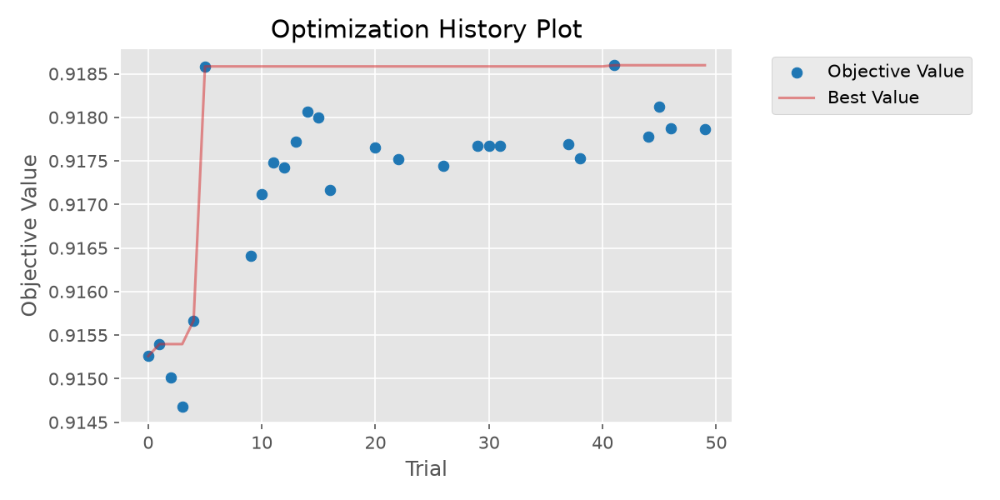

# 4. Bayesian Hyperparameter Optimisation
 
## 4.1 Method
 
- **Model tuned:** LightGBM (selected in §3.4).
- **Optimiser:** Optuna with the Tree-structured Parzen Estimator sampler (`TPESampler(seed=42)`) and a median pruner (`MedianPruner(n_startup_trials=5, n_warmup_steps=1)`). The pruner stops a trial after a fold if its score is below the median of earlier trials at that fold.
- **Objective (maximised):** mean observation Top-1 over 3-fold `GroupKFold` by trip on the training trips (every 4th GPS point, valid rows only). Neither student_test nor the evaluator data was used inside the objective. Log loss and macro-F1 were recorded for each trial.
- **Budget:** 50 trials with a 40-minute cap, giving 27 completed and 23 pruned trials in 22.6 min of wall time.
- **Files:** `results/m2/optuna_trials_v1.csv`, `optuna_best_params_v1.json`, `tuned_vs_untuned_v1.csv`, `tuned_vs_untuned_fulldata_v1.csv`; script `scripts/tune_optuna.py`; notebook `notebooks/03_tuning.ipynb`.
Grid search and random search pick each trial without looking at earlier results. TPE instead splits the finished trials into a better and a worse group by score, fits a density to the parameter values in each group, and samples new values where the ratio of good to poor is highest. As a result, later trials focus on the more promising regions. We maximised Top-1 because that is the metric we use for selection and reporting. Log loss was recorded for every trial so we could check that a higher Top-1 did not come with worse calibration for the HMM.
 
## 4.2 Search space
 
| Hyperparameter                                     | Range                                            | Scale  | Untuned value         |
| -------------------------------------------------- | ------------------------------------------------ | ------ | --------------------- |
| `num_leaves`                                       | 15 – 255                                         | log    | 31                    |
| `learning_rate`                                    | 0.01 – 0.2                                       | log    | 0.05                  |
| `min_child_samples`                                | 10 – 200                                         | log    | 20 (LightGBM default) |
| `colsample_bytree` (feature fraction)              | 0.5 – 1.0                                        | linear | 1.0 (default)         |
| `subsample` (bagging fraction, `subsample_freq=1`) | 0.5 – 1.0                                        | linear | 1.0 (default)         |
| `reg_alpha` (L1)                                   | 0.001 – 10                                       | log    | 0 (default)           |
| `reg_lambda` (L2)                                  | 0.001 – 10                                       | log    | 0 (default)           |
| `n_estimators`                                     | fixed upper bound 2000, early stopping 30 rounds | —      | 500                   |
 
- `num_leaves` sets how complex each tree can get. We used a log scale because going from 15 to 30 leaves changes the model about as much as going from 128 to 255.
- `learning_rate` is the step size for each tree. Small values need more trees (early stopping takes care of this), and since relative changes are what matter, it is searched on a log scale.
- `min_child_samples` is the minimum number of rows in a leaf and acts as a regulariser. With around half a million rows, the useful values cover more than an order of magnitude.
- `colsample_bytree` is the fraction of features each tree sees. With 23 features, some of them overlapping, this makes the trees less correlated. Below 0.5, important features would often be left out.
- `subsample` is the fraction of rows used per tree (bagging). It adds randomness that helps against over-fitting. Below 0.5, too much data would be thrown away.
- `reg_alpha` and `reg_lambda` are L1 and L2 penalties on the leaf values. Their useful values cover several orders of magnitude, so both were searched on a log scale.
- `n_estimators` was not part of the search. We set a high upper bound and let early stopping on held-out trips pick the number of trees for each learning rate.
## 4.3 Results
 
Best trial: **#41**, CV Top-1 **0.9186** (CV log loss 0.0404, CV macro-F1 0.9512).
 
| Hyperparameter      | Best value |
| ------------------- | ---------- |
| `num_leaves`        | 185        |
| `learning_rate`     | 0.02654    |
| `min_child_samples` | 19         |
| `colsample_bytree`  | 0.8395     |
| `subsample`         | 0.7446     |
| `reg_alpha`         | 0.001867   |
| `reg_lambda`        | 0.003274   |
 
Completed trials scored between 0.9147 and 0.9186 CV Top-1 (median 0.9177).
 

 

 
Trial 5 had already reached 0.9186, and the other 45 trials improved on it by less than 0.0001 (trial 41, the best, scored 0.91860). Every completed trial fell between 0.9147 and 0.9186. So TPE found a good region early on, and the objective is quite flat around it. In the importance plot, `colsample_bytree` comes first (0.47), then `reg_alpha` (0.18), `min_child_samples` (0.16) and `learning_rate` (0.12). Within the ranges we searched, `num_leaves` and `reg_lambda` had almost no effect (< 0.01).
 
## 4.4 Tuned vs untuned
 
**(a) Same 3 folds and the same every-4th-point training rows for both:**
 
| Variant | CV Top-1 | CV macro-F1 | CV log loss | ST Top-1 | ST undirected Top-1 | ST macro-F1 | ST log loss | Route continuity | Train time (s) | Inference (ms / 1k) |
| ------- | -------- | ----------- | ----------- | -------- | ------------------- | ----------- | ----------- | ---------------- | -------------- | ------------------- |
| untuned | 0.9156   | 0.9497      | 0.0405      | 0.9162   | 0.9515              | 0.9494      | 0.0373      | 0.793            | 4.7            | 1.48                |
| tuned   | 0.9186   | 0.9512      | 0.0404      | 0.9165   | 0.9525              | 0.9509      | 0.0365      | 0.802            | 16.4           | 2.67                |
 
**(b) Both refit on all valid training rows and scored on student_test:**
 
| Variant | Training rows | Trees (early stopping) | ST Top-1 | ST undirected Top-1 | ST macro-F1 | ST log loss | Route continuity | Breaks | Train time (s) | Inference (ms / 1k) |
| ------- | ------------- | ---------------------- | -------- | ------------------- | ----------- | ----------- | ---------------- | ------ | -------------- | ------------------- |
| untuned | 2,064,331     | 244                    | 0.9159   | 0.9517              | 0.9495      | 0.0386      | 0.794            | 790    | 14.2           | 1.63                |
| tuned   | 2,064,331     | 360                    | 0.9148   | 0.9526              | 0.9513      | 0.0364      | 0.802            | 753    | 36.4           | 3.56                |
 
With the same folds, tuning raised CV Top-1 by 0.0030 (from 0.9156 to 0.9186). On student_test it reduced log loss (0.0373 to 0.0365 in (a), and 0.0386 to 0.0364 in (b)) and gave small improvements in macro-F1, undirected Top-1 and route continuity (0.794 to 0.802, with breaks going from 790 to 753 in (b)). student_test Top-1 hardly changed, though: +0.0003 in (a) and −0.0011 in (b). That is a difference of about 20 GPS points across 10 trips, which is within noise. There are two likely reasons. First, the default settings were already close to the optimum, as all completed trials are within 0.004 of each other. Second, a test set of 10 trips is too small to pick up differences this small. We still exported the tuned model, because it does better on the objective we committed to and is better calibrated, and calibration is what matters for the HMM. The trade-off is roughly double the inference time (3.56 vs 1.63 ms per 1k rows).
 
## 4.5 Exported model
 
`artifacts/model.joblib`: lgbm (tuned), trained on 2,064,331 rows (360 trees), labels `train=M3_alignment; student_test=M3_alignment`. On student_test it scores Top-1 0.9148, log loss 0.0364 and macro-F1 0.9513. Details are in `artifacts/model_card.json`.
 
Feature importance of the exported model (drop in student_test Top-1 when a feature is shuffled; top 5):
 
| Feature            | Top-1 drop (mean ± std, 3 repeats) |
| ------------------ | ---------------------------------- |
| `win5_heading_cos` | 0.2988 ± 0.0034                    |
| `win5_rel`         | 0.0390 ± 0.0016                    |
| `proj_frac`        | 0.0376 ± 0.0018                    |
| `dist_m`           | 0.0245 ± 0.0002                    |
| `dist_minus_min`   | 0.0112 ± 0.0003                    |
 

 
`win5_heading_cos` is by far the most important feature. Shuffling it lowers student_test Top-1 by 0.30, almost eight times more than any other feature. Telling apart the two directions of a two-way road, or picking the right road at a junction, depends mostly on whether the arc's bearing matches the direction of travel over the surrounding window of points. The distance features (`win5_rel`, `dist_m`) mainly help separate parallel roads that are close together. Given more time, we would run more trials using 5-fold CV on all training rows, tune the classifier together with the HMM parameters using route-level metrics, and add a separate probability calibration step (temperature or isotonic scaling) before the HMM.
 