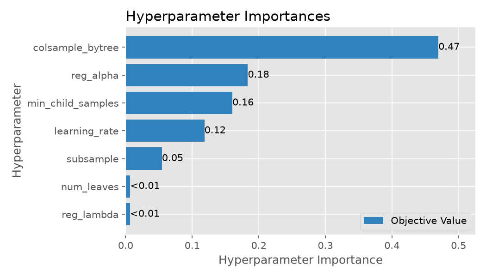
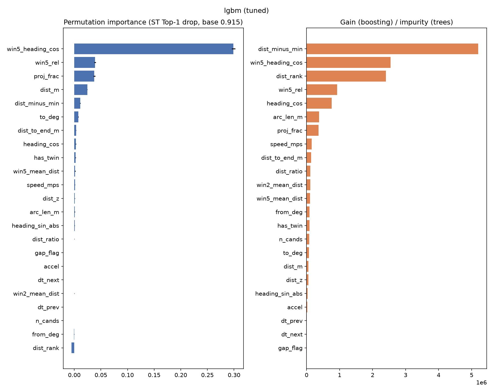

# 4. Bayesian Hyperparameter Optimisation

## 4.1 Method

- **Model tuned:** LightGBM (selected in §3.4).
- **Optimiser:** Optuna, Tree-structured Parzen Estimator sampler (`TPESampler(seed=42)`), with a median pruner (`MedianPruner(n_startup_trials=5, n_warmup_steps=1)`) that stops a trial after a fold if it is below the median of earlier trials at that fold.
- **Objective (maximised):** mean observation Top-1 over 3-fold `GroupKFold` by trip on the training trips (every 4th GPS point, valid rows only). student_test and evaluator data were never used inside the objective. Log loss and macro-F1 were recorded for every trial.
- **Budget:** 50 trials, 40-minute cap → 27 completed, 23 pruned, wall time 22.6 min.
- **Files:** `results/m2/optuna_trials_v1.csv`, `optuna_best_params_v1.json`, `tuned_vs_untuned_v1.csv`, `tuned_vs_untuned_fulldata_v1.csv`; script `scripts/tune_optuna.py`; notebook `notebooks/03_tuning.ipynb`.

> ✍️ **WRITE (own words):** 2–3 sentences: what TPE does differently from grid/random search, and why Top-1 was chosen as the objective (and log loss only recorded).

## 4.2 Search space

| Hyperparameter | Range | Scale | Untuned value |
|---|---|---|---|
| `num_leaves` | 15 – 255 | log | 31 |
| `learning_rate` | 0.01 – 0.2 | log | 0.05 |
| `min_child_samples` | 10 – 200 | log | 20 (LightGBM default) |
| `colsample_bytree` (feature fraction) | 0.5 – 1.0 | linear | 1.0 (default) |
| `subsample` (bagging fraction, `subsample_freq=1`) | 0.5 – 1.0 | linear | 1.0 (default) |
| `reg_alpha` (L1) | 0.001 – 10 | log | 0 (default) |
| `reg_lambda` (L2) | 0.001 – 10 | log | 0 (default) |
| `n_estimators` | fixed upper bound 2000, early stopping 30 rounds | — | 500 |

> ✍️ **WRITE (own words):** one line per row justifying the range (what the parameter controls, why log scale where used).

## 4.3 Results

Best trial: **#41**, CV Top-1 **0.9186** (CV log loss 0.0404, CV macro-F1 0.9512).

| Hyperparameter | Best value |
|---|---|
| `num_leaves` | 185 |
| `learning_rate` | 0.02654 |
| `min_child_samples` | 19 |
| `colsample_bytree` | 0.8395 |
| `subsample` | 0.7446 |
| `reg_alpha` | 0.001867 |
| `reg_lambda` | 0.003274 |

Completed trials ranged from 0.9147 to 0.9186 CV Top-1 (median 0.9177).

> ✍️ **WRITE (own words):** what the history shows (when the best region was found, how much later trials improved) and which hyperparameters mattered most according to the importance plot.

## 4.4 Tuned vs untuned

**(a) Same 3 folds and the same every-4th-point training rows for both:**

| Variant | CV Top-1 | CV macro-F1 | CV log loss | ST Top-1 | ST undirected Top-1 | ST macro-F1 | ST log loss | Route continuity | Train time (s) | Inference (ms / 1k) |
|---|---|---|---|---|---|---|---|---|---|---|
| untuned | 0.9156 | 0.9497 | 0.0405 | 0.9162 | 0.9515 | 0.9494 | 0.0373 | 0.793 | 4.7 | 1.48 |
| tuned | 0.9186 | 0.9512 | 0.0404 | 0.9165 | 0.9525 | 0.9509 | 0.0365 | 0.802 | 16.4 | 2.67 |

**(b) Both refit on all valid training rows and scored on student_test:**

| Variant | Training rows | Trees (early stopping) | ST Top-1 | ST undirected Top-1 | ST macro-F1 | ST log loss | Route continuity | Breaks | Train time (s) | Inference (ms / 1k) |
|---|---|---|---|---|---|---|---|---|---|---|
| untuned | 2,064,331 | 244 | 0.9159 | 0.9517 | 0.9495 | 0.0386 | 0.794 | 790 | 14.2 | 1.63 |
| tuned | 2,064,331 | 360 | 0.9148 | 0.9526 | 0.9513 | 0.0364 | 0.802 | 753 | 36.4 | 3.56 |

> ✍️ **WRITE (own words):** an honest reading: what improved (CV Top-1, log loss, continuity) and what did not (student_test Top-1 roughly unchanged), why that can happen (defaults already near the optimum; 10 test trips), and why the tuned model was still exported (objective + calibration for the HMM).

## 4.5 Exported model

`artifacts/model.joblib` — lgbm (tuned), trained on 2,064,331 rows (360 trees), labels `train=M3_alignment; student_test=M3_alignment`. student_test: Top-1 0.9148, log loss 0.0364, macro-F1 0.9513. Details in `artifacts/model_card.json`.

Feature importance of the exported model (drop in student_test Top-1 when a feature is shuffled; top 5):

| Feature | Top-1 drop (mean ± std, 3 repeats) |
|---|---|
| `win5_heading_cos` | 0.2988 ± 0.0034 |
| `win5_rel` | 0.0390 ± 0.0016 |
| `proj_frac` | 0.0376 ± 0.0018 |
| `dist_m` | 0.0245 ± 0.0002 |
| `dist_minus_min` | 0.0112 ± 0.0003 |

> ✍️ **WRITE (own words):** 1–2 sentences on what the dominant feature tells us, and what you would do with more time (e.g. more trials, tuning jointly with the HMM, calibration).

