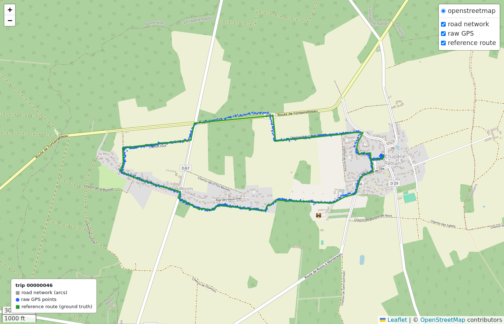
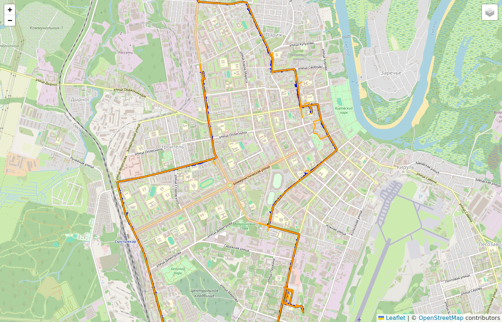
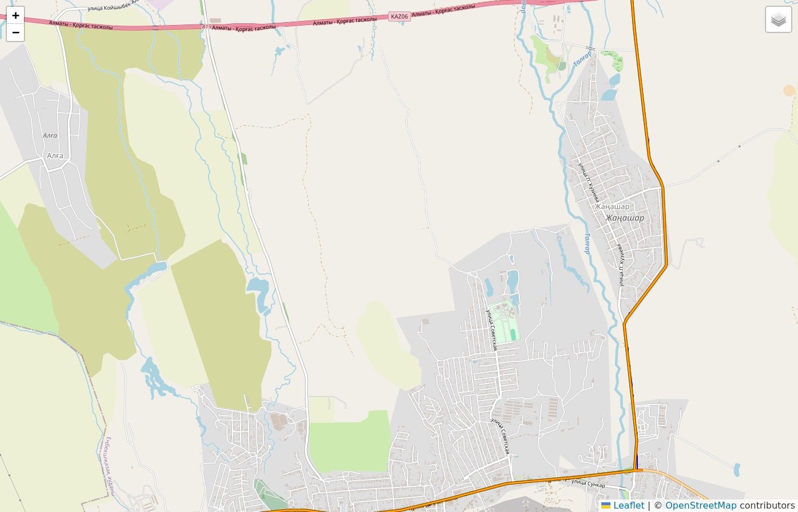

# 6. Geographical Visualisation (Folium)

All maps are generated by code in the repository from our actual data and predictions:

| Map | Generated by | What it shows | Partition |
|---|---|---|---|
| `results/maps/eda_<trip>.html` | `scripts/make_maps.py` | road network (grey), raw GPS observations (blue), reference route (green) | train |
| `results/maps/hmm_helps_<trip>.html` | `scripts/eval_hmm.py` | GPS, reference route, classifier-only route, classifier + HMM route | student_test |
| `results/maps/hmm_fails_<trip>.html` | `scripts/eval_hmm.py` | same layers, for a trip where the HMM did not improve Top-1 | student_test |
| Evaluator UI map (live) | `ui/app.py` | raw GPS (blue points) and predicted route (red line) returned by the API | evaluator_test (demo) |

Every map uses distinguishable colours per layer, a legend, a `LayerControl` so each layer can be switched on and off, and bounds fitted to the trip's extent.

**Figure 6.1:** EDA map of a train trip (GPS vs. reference route vs. road network).

**Figure 6.2:** A student_test trip where HMM decoding fixes classifier-only jumps between parallel / twin roads.

**Figure 6.3:** A student_test trip where HMM decoding did not help (discussed in §5).

The interactive HTML versions are committed under `results/maps/`.
