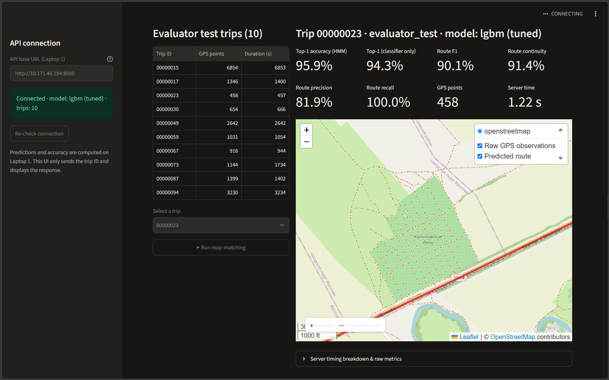
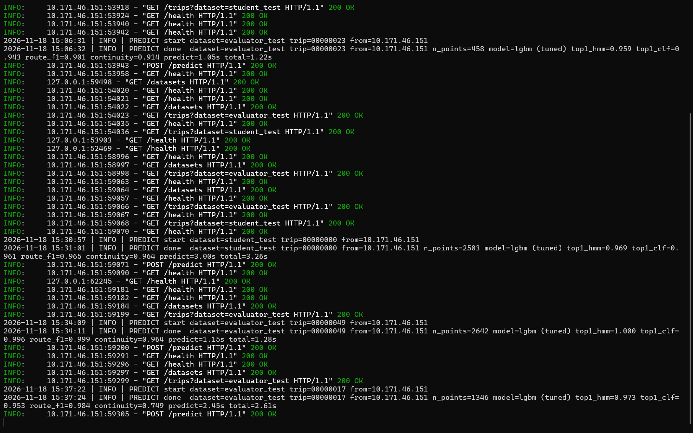
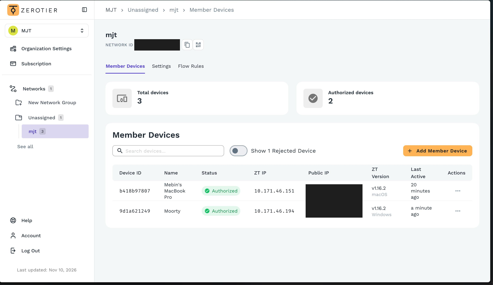

# 7. API, UI and Deployment

## 7.1 Architecture

```
Laptop 2 (UI)                         ZeroTier private network                  Laptop 1 (Model + API)
streamlit run ui/app.py  -- HTTP/JSON -->  virtual LAN (10.x.x.x)  -->  uvicorn api.main:app --host 0.0.0.0 :8000
trip list, map, metrics  <------------------------------------------  predictor (classifier + HMM) + server-side scoring
```

- **Laptop 1** holds the trained model (`artifacts/model.joblib`, tuned LightGBM), the HMM configuration (`artifacts/hmm_config.json`), the road networks and the evaluation trips. It runs the FastAPI server.
- **Laptop 2** runs only the Streamlit UI. It imports none of the prediction code and talks to the API only over HTTP.
- **ZeroTier** puts both laptops on a private virtual network:
  - Access Control is set to Private, and each laptop is authorised in ZeroTier Central.
  - Each laptop gets a managed IP.
  - The API port (TCP 8000) is opened in Laptop 1's firewall.

## 7.2 API (`api/main.py`)

| Endpoint | Purpose |
|---|---|
| `GET /health` | status, loaded model name, number of available trips |
| `GET /trips` | trips discovered **at runtime** from the evaluation folder (`PATHSNAP_EVAL_DIR`); nothing is hardcoded |
| `POST /predict {"trip_id"}` | runs the complete pipeline, then scores the prediction server-side |

**Model loading.** The predictor is loaded once at startup. Each `/predict` request is handled in a worker thread.

**Requests.** Unknown trip IDs are rejected with 404. This is a whitelist check against the discovered folders, so it also prevents path traversal.

**Prediction pipeline.** `PathSnapPredictor.predict_trip` reads only `.track`, `.nodes` and `.arcs` and then runs:
1. per-trip projection;
2. candidate generation;
3. features;
4. LightGBM probabilities;
5. Viterbi decoding;
6. gap-filled route.

**Scoring.** Accuracy is computed afterwards by `scoring.score_trip`. This is the only serving-time code that reads the reference `.route` file. The response carries **only aggregate metrics**: Top-1 (HMM and classifier-only), route precision/recall/F1 and continuity. The reference route never leaves Laptop 1.

**Logging.** Every request produces log lines on Laptop 1's terminal (trip, client IP, accuracy, latency) and a JSON line in `results/api/requests.log`.

## 7.3 Evaluator UI (`ui/app.py`)

The sidebar takes the API URL (Laptop 1's ZeroTier IP) and shows a connection badge. The main view:
- lists the evaluation trips returned by `/trips`;
- sends the selected trip ID to `/predict`;
- shows metric cards and a Folium map of the raw GPS points and the predicted route;
- keeps a history table of the runs in the session.

## 7.4 Rehearsal results

`api/smoke_test.py` sends every trip through the API from Laptop 2 and records per-trip latency, which is saved to `results/api/latency_<host>.csv`.

## 7.5 Screenshots

**Figure 7.1:** Evaluator UI on Laptop 2 showing a predicted route and its metrics.



**Figure 7.2:** API request logs in the terminal of Laptop 1 (the receiving laptop).



**Figure 7.3:** ZeroTier Central members page with both laptops authorised. The network ID is hidden.


